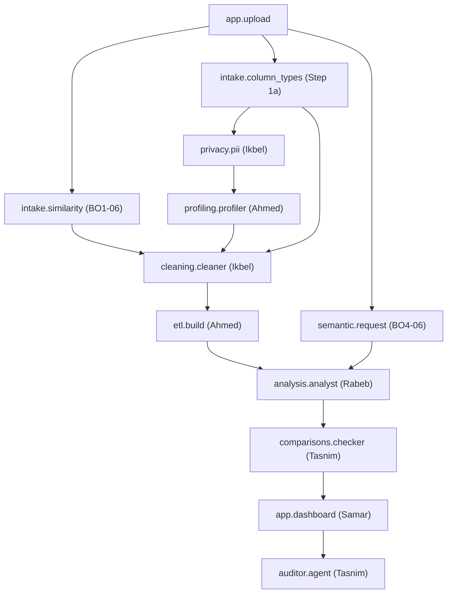

# BIFlow Integration Guide — Semantic Detection & Orchestration

**Audience:** BIFlow Agent Developers (Ahmed, Ikbel, Rabeb, Tasnim, Samar, Malek)  
**Branch:** `BO1/Samar+Malek`

---

## 1. DAG Execution Flow

Step 1a (`intake.column_types:run`) and Step 0 (`intake.similarity:run`) are among the first agents executed after data intake (`app.upload:run`).

---

## 2. Consumed Inputs and Produced Outputs

### Step 1a: `column_types`
- **Owner:** Malek
- **Inputs:** `tables` (`upload.tables`) -> Directory containing source CSV files.
- **Outputs:** `report` -> `runs/<run_id>/column_types/column_types.json`.
- **Contract Produced:** `contracts.intake.ColumnTypesReport`.

### Downstream Consumers
1. **`privacy.pii` (Ikbel):**
   Reads `column_types.report` to prioritize inspection on columns where `pii_candidate == True`.
2. **`cleaning.cleaner` (Ikbel):**
   Uses `column_types.report` to select appropriate cleaning transforms and null imputations based on `semantic_type`.
3. **`profiling.profiler` (Ahmed):**
   Uses column types to tailor metric distributions and anomaly detection algorithms.

---

## 3. Resume-on-Failure and Orchestrator Integration

The orchestrator (`orchestrator.dag_runner`) uses the SQLite task store (`runs/task_store.db`):
- When resuming an incomplete or interrupted run with the same `run_id`, tasks marked `SUCCESS` whose output files already exist on disk are skipped.
- When an agent encounters ambiguity and returns `AgentStatus.NEEDS_REVIEW`, the task is marked as `TaskStatus.NEEDS_REVIEW` in the task store, and downstream tasks proceed if dependencies permit.
