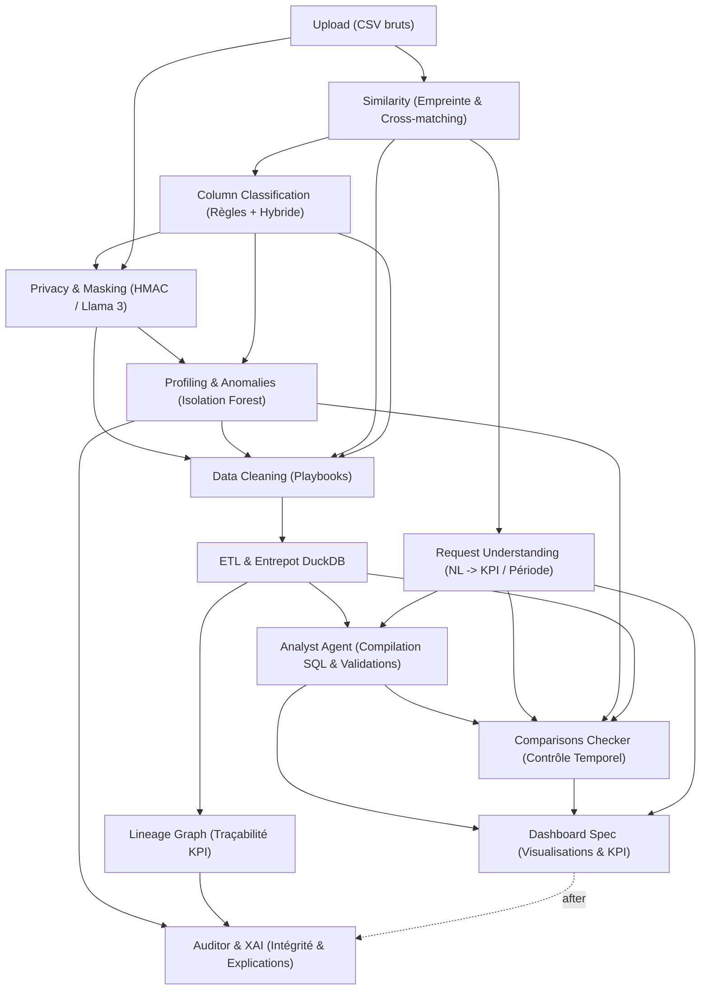

# BIFlow — Décisions d'Ordonnancement et Architecture du DAG

Ce document consigne les décisions d'architecture et de gouvernance du DAG d'orchestration BIFlow, implémentées dans `contracts/pipeline.py` et `orchestrator/dag_runner.py`.

---

## 1. Ordonnancement Cible et Dépendances Réelles

Le DAG implémente l'ordonnancement optimal validé par l'ensemble des parties prenantes :



### Ordre d'Exécution Linéarisé (`TopologicalSorter`)
```text
upload -> similarity -> column_types -> request -> pii -> profiling -> cleaning -> etl -> analysis -> lineage -> comparisons -> dashboard -> auditor
```

---

## 2. Principes Fondamentaux et Barrières

### 2.1. Précédence Sémantique
- **Similarité en amont :** La similarité s'exécute immédiatement après `upload` sur les métadonnées de structure (schémas et noms de colonnes). Elle fournit la reconnaissance globale du dataset (`olist`) et le catalogue de correspondances inter-tables (`column_matches.json`).
- **Classification sémantique :** Attend `similarity` et qualifie exhaustivement les 52 colonnes sans exposer de valeurs PII brutes, générant à la fois le contrat standard `column_types.json` et les métadonnées riches `semantic_metadata.json`.
- **Request Understanding en parallèle :** Une fois `similarity` et `upload` complétés, `request` peut s'exécuter en parallèle de la branche de préparation des données (`pii` / `profiling` / `cleaning`).

### 2.2. Barrières Infranchissables de Dépendances
- **Blocage sur `NEEDS_REVIEW` :** Tout résultat nécessitant une intervention humaine (`AgentStatus.NEEDS_REVIEW`) suspend immédiatement toutes les tâches dépendantes directes et indirectes (marquées `SKIPPED` avec motif explicite).
- **Propagation transitive d'échec :** Dans une chaîne $A \to B \to C$, si $A$ échoue (`FAILED`) ou est suspendu (`NEEDS_REVIEW`), $B$ est ignoré (`SKIPPED`) et $C$ est immédiatement ignoré (`SKIPPED`).
- **Continuation sélective (`stop_on_failure=False`) :**
  - Permet aux branches réellement indépendantes de s'exécuter (ex: `request` peut se terminer si `pii` échoue).
  - **N'outrepasse JAMAIS une barrière obligatoire :** Toute étape dont un prérequis a échoué est strictement bloquée, prévenant toute fuite de données non masquées ou consommation d'artefacts inexistants.

---

## 3. Reprise sur Panne et Invalidation d'État

Avant de réutiliser un statut `TaskStatus.SUCCESS` existant dans la base SQLite :
1. **Contrôle des dépendances :** TOUS les prérequis amont de l'étape doivent être présents dans le run courant avec le statut `AgentStatus.SUCCESS`. Si un prérequis a été réexécuté ou a échoué, l'étape ne peut pas être réutilisée et est réexécutée.
2. **Contrôle d'intégrité physique des sorties :**
   - Tous les fichiers déclarés dans `step_def.outputs` doivent exister dans `runs/<run_id>/<step_name>/`.
   - Les fichiers ne doivent pas être vides (taille > 0 octets).
   - Les fichiers `.json` doivent être syntaxiquement valides (`json.loads`).
   - Les fichiers `.parquet` doivent comporter l'en-tête binaire `PAR1`.
3. **Isolation de Run :** Tout chemin pointant en dehors de l'arborescence `runs/<run_id>/<step_name>/` est formellement rejeté.

---

## 4. Politique de Tentatives (Retry Policy)

L'orchestrateur expose une politique de retry sélective :
- **Exceptions réessayables (transitoires) :** `TimeoutError`, `ConnectionError`, `OSError` avec errnos réseau temporaires (EAGAIN, ETIMEDOUT, WSAECONNABORTED).
- **Exceptions non réessayables (déterministes) :** `ValueError`, `TypeError`, `KeyError`, `AttributeError`, `FileNotFoundError`, `pydantic.ValidationError`, `json.JSONDecodeError`. Ces erreurs échouent immédiatement sans retry pour éviter de masquer des défauts structurels.
- **Paramétrage :** `max_retries: int = 1`, `retry_delay: float = 0.0`.
